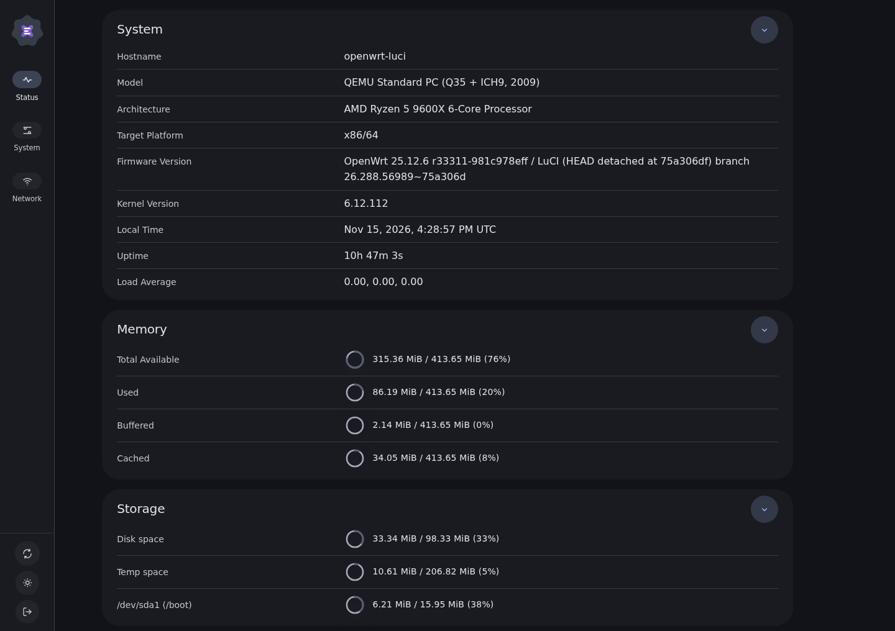
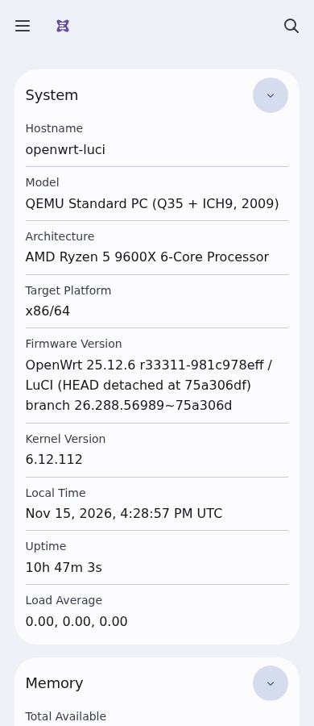

# MD3E Theme

MD3E is a Material Design 3 Expressive-inspired theme for OpenWrt LuCI.

Package: `luci-theme-md3e`

The theme keeps the OpenWrt LuCI package layout from `tickcount/luci-theme`, with the UI rebuilt around a token-first Material-style system adapted for router workflows.

## Source Layout

Editable source lives under `.dev/`; generated package output lives under `htdocs/luci-static/`.

- `.dev/src/media/main/` contains split CSS source parts for the LuCI theme.
- `.dev/src/resource/menu-md3e-v2/` contains split LuCI runtime JavaScript parts.
- `.dev/src/public-md3e/components/` contains split public component CSS.
- `.dev/scripts/source-assemblies.js` is the manifest that assembles split source parts into `.dev/src/media/main.css`, `.dev/public/md3e/components.css`, and `.dev/src/resource/menu-md3e-v2.js`.
- `htdocs/luci-static/` is regenerated build output. Do not edit generated files without the matching `.dev/src/` source change.

## Development

Run commands from `.dev/`.

```sh
npm run assemble
npm run build
npm run verify:with-generated-index
```

`npm run verify:with-generated-index` is the safest full local gate for this repository. It builds the generated output, temporarily stages `htdocs/luci-static/` so `verify:generated` can compare against the intended index state, runs the verification suite, and unstages the generated files afterward. If generated output was clean before the run, it restores that working tree after verification; if it was already dirty, it leaves the existing generated changes available for inspection or commit.

Use `npm run verify` when `htdocs/luci-static/` has already been staged intentionally. Run `npm run build` after a clean `verify:with-generated-index` when you want regenerated package output to remain for a release commit.

## Verification Gates

The verification suite checks formatting, source part manifests, per-part size budgets, release/cache alignment, breakpoint constants, asset mirroring, template includes, local artifact ignores, critical selector invariants, runtime observer lifecycles, blur guards, page-outline behavior, preview smoke coverage, generated output parity, Terser output, Tailwind scan scope, and CSS/JS size budgets. Local browser profiles, Playwright installs, device diagnostics, package artifacts, and router workflow notes are intentionally ignored.

Important targeted checks:

- `npm run verify:source-parts` ensures every numbered source part is listed in `source-assemblies.js`.
- `npm run verify:source-part-budget` prevents individual CSS/JS source parts from growing into hard-to-review files.
- `npm run verify:generated` confirms `htdocs/luci-static/` matches a fresh `.dev` build.
- `npm run verify:device-interfaces` checks the installed LuCI UI on a router, including interface cards and mobile layout invariants.

## Device Deployment

The local device workflow defaults to `root@10.0.0.1` and `http://10.0.0.1/cgi-bin/luci/`.

```sh
npm run deploy:device-static
npm run verify:device-interfaces
```

`deploy:device-static` copies the built static files and MD3E templates to the router, clears LuCI caches, verifies remote SHA-256 hashes, and checks static HTTP responses. `verify:device-interfaces` uses a local temporary Playwright runtime when needed and keeps `.tmp-playwright/` plus diagnostics ignored.

## Release Notes

When bumping a package release, keep these values aligned:

- `Makefile`: `PKG_VERSION` and `PKG_RELEASE`
- `ucode/template/themes/md3e/header.ut`: `release_cache_version`
- regenerated `htdocs/luci-static/` output from a fresh `.dev` build

Local router credentials, logs, screenshots, diagnostics, temporary Playwright installs, and workflow notes should remain untracked.

## Preview






## Font Licenses

This repository redistributes the following third-party font files:

- `Inter` under the SIL Open Font License 1.1. See `ucode/template/themes/LICENSES/Inter-OFL-1.1.txt`.
- `Geist Mono` under the SIL Open Font License 1.1. See `ucode/template/themes/LICENSES/Geist-OFL-1.1.txt`.

## Credits

This theme references ideas, structure, or implementation patterns from the following repositories:

- [tickcount/luci-theme](https://github.com/tickcount/luci-theme)
  Package layout, build architecture, and the source-first workflow used by this repository.

- [saku-bruh/luci-theme-material3](https://github.com/saku-bruh/luci-theme-material3)
  Visual reference for LuCI-specific Material 3 theming patterns and prior router UI adaptation work.

- [material-components/material-web](https://github.com/material-components/material-web)
  Reference for Material token structure, especially the `md-sys-*` and `md-comp-*` style of system and component tokens.

- [openwrt/luci](https://github.com/openwrt/luci)
  Upstream LuCI templates, behaviors, and runtime constraints that the theme has to adapt to.
